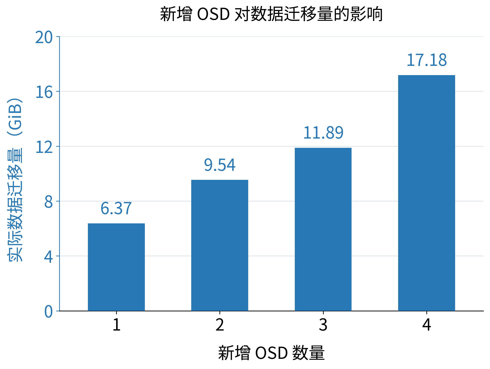
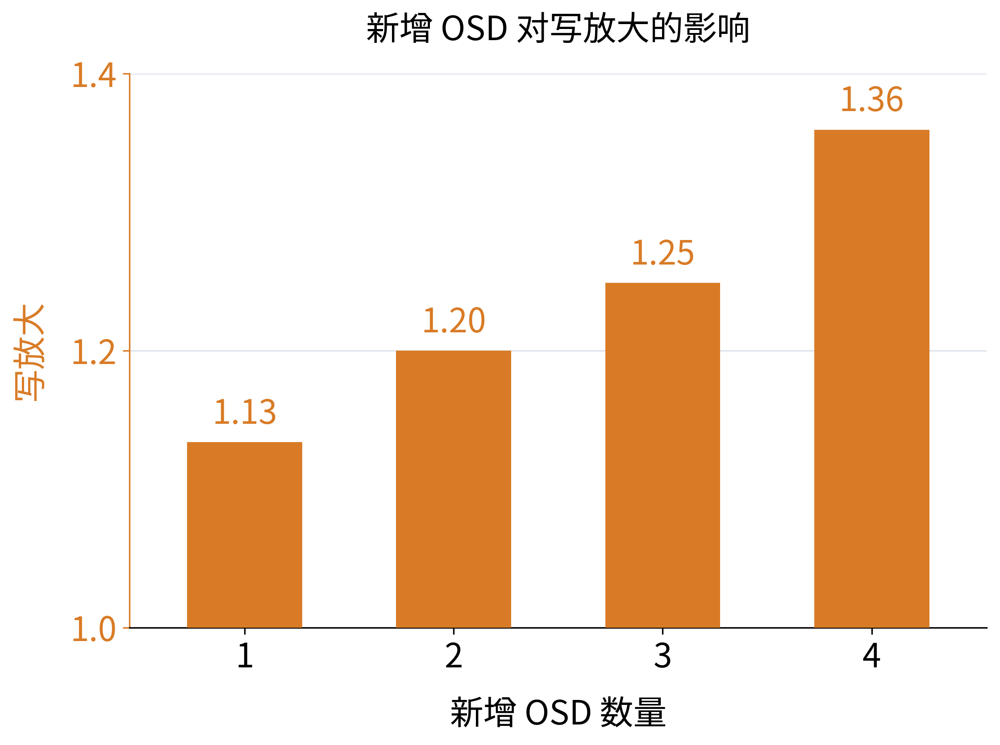

# PG 均衡写放大实验：8 → 9 / 10 / 11 / 12 OSD

在既有 Ceph 17.2.7 `snapWrite` 集群上验证：客户端不再写入时，将测试池的放置范围
从 node1/node2 的 8 个 OSD 扩展到 9、10、11 或 12 个 OSD，会引起额外的数据接收和写入。
通过 `--add-osds N` 选择 node3 的 OSD 8 至 8+N-1；默认 N=4，保持原实验入口行为。

新增 1、2、3 个的对比和此前新增 4 个的参考结果统一放在
[comparison-report.md](comparison-report.md)、[comparison.csv](comparison.csv)
和 [comparison.json](comparison.json)。这三组各自从 8 个 OSD 重新装载 16 GiB，
不是连续执行 8→9→10→11 扩容。

## 新增 1、2、3 个 OSD 的正式结果

三组测试均已完成，每组客户端成功写入 16 GiB，均衡期间客户端写入增量为 0，
全部 4,096 个对象完整读回一致。以下数据来自
[本次系列记录](results/20261110T125223Z-series/series.json)。

| 新增 OSD | 参与 OSD | 理想迁移 GiB | 实测数据迁移 GiB | 累计消息接收放大 |
|---:|---:|---:|---:|---:|
| 1 | 8→9 | 5.333333 | 6.371094 | **1.133805×** |
| 2 | 8→10 | 9.600000 | 9.539062 | **1.199798×** |
| 3 | 8→11 | 13.090909 | 11.886719 | **1.248742×** |

“实测数据迁移”使用 `push_out_bytes`；三组都与 PG 映射推导的迁移量完全相等。
消息接收量还包含协议和控制消息。新增 2 个的结果接近 9.6 GiB、1.2× 的均匀分布估算。
新增 1、3 个与理论值的偏差主要体现在实际 PG/对象分布；每组的旧 OSD 间迁移也单列在
对比报告中。各组使用不同池 ID，具体 PG 布局不同，每种数量只有一次正式运行。

三组均完成测试池、规则和池专属权重集清理，原配置已恢复。新脚本先删除测试池，
Ceph 会在同一次操作中删除其权重集，避免清理时又把未加入的 OSD 纳入并引起第二次迁移。
系列控制台记录位于 [console.txt](results/20261110T125223Z-series/console.txt)。

## 柱状图





两张独立柱状图的横轴均为新增 OSD 数量 1–4。蓝色柱显示实际数据迁移量（GiB），
橙色柱显示写放大（按累计消息接收量计算）。两图数值标签均保留两位小数，不带乘号。
写放大图的纵坐标范围为 1–1.4。
全部字体为 **18 pt**，读取
`comparison.csv` 的 `actual_data_migration_bytes` 和 `cumulative_receive_amplification`，
不绘制理论估算。新增 4 个的数据来自此前正式测试。

```bash
python3 -B Exp_PGBalanceWriteAmplification/plot_pgbalance.py --font-size 18
```

输出为 `figures/pgbalance_migration.*` 和 `figures/pgbalance_write_amplification.*`，
每图均含 PNG（300 dpi）、PDF 和 SVG；
脚本为 [plot_pgbalance.py](plot_pgbalance.py)。需要 Matplotlib 和中文字体（本机使用 Noto Sans CJK）。

## 此前新增 4 个 OSD 的正式结果

**2026-11-10 20:13（北京时间）开始的 16 GiB 正式测试已完成。**
完整报告见 [report.md](results/20261110T121338Z-formal/report.md)，
原始记录和逐 OSD/PG 数据保存在同一结果目录。

| 指标 | 实测 |
|---|---:|
| 客户端成功提交 | 17,179,869,184 B，16 GiB |
| 初始三副本消息接收 | 51,563,485,128 B |
| 均衡期间新增消息接收 | 18,497,625,847 B，约 17.227 GiB |
| 初始装载接收放大 | 1.000463× |
| 装载加均衡累计接收放大 | **1.359364×** |
| 相对实测初始接收量的增幅 | **35.873%** |
| 均衡期间客户端写入字节增量 | **0** |
| 均衡窗口 / 匹配空闲窗口接收量 | 489.4 倍 |
| 完整读回校验 | 全部 4,096 个对象、16 GiB 通过 |

实际 PG 映射需要搬运 18,450,743,296 B，和实测 `push_out_bytes` **完全相等**。
其中 node3 获得 16.550781 GiB，旧 OSD 之间另外迁移 0.632812 GiB；
按该数据量推导的归一化值为 1.357992×。BlueStore 数据写入路径实测累计值为
1.357997×，也与此一致。消息接收主指标包含额外协议和控制消息，因而略高。

测试池、专属规则和权重集已删除；CRUSH 内容、原有池、全局 flags 和 balancer
启用状态均已核对恢复，12 个 OSD up/in、全部 PG clean。仅保留原有 MON_DISK_LOW 告警。
此次运行没有修改 Ceph 源码或重启守护进程。

## 实验口径

用户定义的归一化写放大是：

```text
A = 全部 OSD 接收的写入数据字节 / (3 × 客户端成功提交的逻辑数据字节)
```

本实验以原生 `AsyncMessenger::Worker-* / msgr_recv_bytes` 的增量近似分子。
它包含消息头、事务元数据、心跳及其他控制消息，因此主结果明确称为“消息接收放大”，
不把它解释为精确的纯数据 payload 或 SSD 物理写放大。普通三副本装载的实测基线
也保留其原值，不强制写成 1。RDMA worker 的 `rx_bytes` 单独保留，不能与 Messenger
字节相加，否则同一数据会被重复计入。

另外记录以下交叉核对项：

- BlueStore `write_big_bytes + write_small_bytes`：全部 OSD 数据写入路径处理量，包含内部对象
  写入、不能按池过滤，和接收口径分别报告。新增 1 个的初始窗口比 `3D` 多 109,614 B，
  原始数值保留；测试池的三副本布局和数据量使用 PG 映射、对象统计及读回校验核对。
- `push_out_bytes`：恢复/回填构建的推送数据量；它在发送侧更新，不冒充目标端接收计数。
- 每个 PG 前后 acting set 和对象字节数：推导新增副本位置需要搬运的数据量。
- node3 的 `bluestore.stored` 增量：验证新位置实际保存了数据。
- 均衡前后测试池的累计写操作/字节保持相同，最终完整读回所有对象。

## 布局与步骤

默认 4,096 个 4 MiB 对象，共 **16 GiB** 客户端数据；三副本、128 PG、并发 32，
关闭测试池压缩、PG 自动调整和 scrub，不创建快照。

由于初始只有两台承载数据的主机，测试池使用单独创建的 `failure-domain=osd` CRUSH
规则，允许同主机不同 OSD 存放副本。三副本配置和规则从头到尾不变。

既有 `.mgr` 池使用 `host` 故障域。如果将 node3 的 4 个 OSD 全局 out，它会缺副本。
因此这里使用 Ceph 原生的 **per-pool flat weight set**，只将测试池在根桶中选择 node3
的权重设为 0。8 个 OSD 上的数据完整三副本、所有 PG clean 后装载数据；随后一条
weight-set reweight 命令恢复 node3 的权重，让选中的 N 个 OSD 同时参与该池放置。
当 N<4 时，在装载前先将未加入的 node3 叶子 OSD 的池权重设为 0，再将 node3 桶
权重设为 0；扩容时仅把桶权重恢复为选中的叶子权重之和。扩容前后 PG 映射会检查
实际参与 OSD ID 恰为 `0..7` 和 `0..(7+N)`。
12 个守护进程全程 up/in，其他池的放置规则和全局设备权重不变。

测量阶段如下：

1. 创建临时规则、测试池和独立权重，暂停自动 balancer 并记录原状态。
2. 排除 node3，检查所有测试 PG 均在 OSD 0–7 上且具有 3 个不同 OSD 副本。
3. 记录 8 OSD 空闲背景；写入固定数据，等待三副本完成、PG 统计和数据计数收敛。
4. 恢复 node3 在该池的所选 OSD 权重；不再向测试池提交写入，等待均衡、PG 清理和数据计数收敛。
5. 记录与均衡阶段近似等长的最终布局空闲窗口，主结果不扣除该背景。
6. 测量结束后完整读回全部对象，逐字节核对内容；删除本次测试池、权重和规则，恢复
   balancer，核对 CRUSH 内容、全局 flags、既有池和 12 OSD up/in 状态。

初始装载和均衡阶段的接收量相加形成累计值；单列的空闲控制、读回校验和删除池的
流量不加入主结果。每个阶段的原始快照与时间戳都保留。计数器不重置；若 PID/进程
启动时间变化或单调计数器下降，测试失败，不跨重启计算增量。

等权且分布均匀、只发生必要数据迁移时，理想迁移量是 `48 GiB × N/(8+N)`，
理想归一化放大是 `1 + N/(8+N)`：

| 新增 OSD | 理想迁移 GiB | 理想累计放大 |
|---:|---:|---:|
| 1 | 5.333333 | 1.111111× |
| 2 | 9.600000 | 1.200000× |
| 3 | 13.090909 | 1.272727× |
| 4 | 16.000000 | 1.333333× |

实际 PG 分布和旧 OSD 之间的额外迁移可能使结果不同，报告会用实际 PG 映射和字节数核对。

## 运行

在 node4 上：

```bash
./Exp_PGBalanceWriteAmplification/run.sh
```

分别新增 1、2、3 个，完成每组清理后才运行下一组，并生成对比文件：

```bash
python3 -B Exp_PGBalanceWriteAmplification/run_series.py \
  --reference Exp_PGBalanceWriteAmplification/results/20261110T121338Z-formal
```

只运行其中一组，例如新增 2 个：

```bash
./Exp_PGBalanceWriteAmplification/run.sh --add-osds 2 --label formal-add2
```

小规模端到端检查：

```bash
./Exp_PGBalanceWriteAmplification/run.sh \
  --objects 64 --pg-num 32 --idle-seconds 5 --label smoke
```

入口使用匹配的 Python `rados` 绑定、动态库和 RDMA unlimited memlock。
默认源码 `/home/cyf/ceph-dpu`，可以用 `CEPH_SOURCE_DIR` 覆盖；集群包装脚本默认从
实验目录的父目录读取，可用 `CEPH_LAB_DIR` 覆盖。SSH 用户 cyf、端口 23579，需要
免密 SSH 和 `sudo -n`。探针通过 SSH 标准输入运行，无需在 OSD 节点部署文件。

输入数据由固定 SHAKE256 模板和对象序号在内存中生成，不保存 16 GiB 客户端输入文件。
脚本预检要求集群只有既有 `.mgr` 池且 12 个 OSD up/in；避免把已有用户池流量混入测量。
本实验是单次现象验证，不提供重复实验的置信区间。

## 文件与输出

| 文件 | 内容 |
|---|---|
| `run.sh` | 匹配绑定、动态库和 RDMA 的运行入口 |
| `test_pgbalance.py` | 创建测试资源、写入、均衡、采集、验证、清理及离线汇总 |
| `osd_probe.py` | 只读 admin socket 探针，记录完整 perf 与进程身份 |
| `run_series.py` | 串行执行独立的 +1/+2/+3 正式测试，保留系列记录和控制台输出 |
| `compare_pgbalance.py` | 从已完成结果离线生成对比 CSV、JSON 和报告 |
| `comparison-report.md` / `comparison.csv` / `comparison.json` | 不同新增 OSD 数量的汇总 |
| `results/<UTC时间>-<label>/results.json` | 参数、命令、版本、PG 映射、健康状态、验证和恢复记录 |
| `results/<UTC时间>-<label>/raw-counters.json.gz` | 所有测量边界的完整 OSD 原始 perf 快照 |
| `results/<UTC时间>-<label>/summary.json` | 汇总、归一化指标和 PG 映射推导 |
| `results/<UTC时间>-<label>/per-osd.csv` | 分阶段、逐 OSD 的接收和数据写入等增量 |
| `results/<UTC时间>-<label>/pg-movement.csv` | 逐 PG 的副本位置变化和必要迁移字节 |
| `results/<UTC时间>-<label>/report.md` | 对应运行的可读报告 |

离线重建汇总只依赖 Python 标准库，不访问集群：

```bash
python3 -B Exp_PGBalanceWriteAmplification/test_pgbalance.py \
  --summarize Exp_PGBalanceWriteAmplification/results/<结果目录>
```

所有成功、失败或预检运行的记录均保留在本目录，不删除历史运行。

运行记录：

- `20261110T120911Z-smoke`：首次 256 MiB 检查。librados 汇总仍为旧对象数，校验中止；
  原始记录和错误均保留，资源已恢复。随后补充汇总统计收敛检查，并区分逻辑与 raw 字节。
- `20261110T121152Z-smoke-recheck`：256 MiB 完整复测通过，64 个对象内容验证通过，
  累计消息接收放大 1.373775×。
- `20261110T121338Z-formal`：上述 16 GiB 正式测试。
- `20261110T124831Z-smoke-add1`：只加入 OSD 8 的 256 MiB 完整流程检查通过，
  最终 PG 仅使用 OSD 0–8，未加入的 OSD 9–11 没有测试池副本。
- `20261110T125223Z-formal-add1`：新增 1 个的 16 GiB 正式测试。
- `20261110T125704Z-formal-add2`：新增 2 个的 16 GiB 正式测试。
- `20261110T130140Z-formal-add3`：新增 3 个的 16 GiB 正式测试。

参考：
[Ceph Quincy per-pool weight set](https://docs.ceph.com/en/quincy/rados/operations/crush-map/#creating-per-pool-weight-sets)、
[perf counters](https://docs.ceph.com/en/quincy/dev/perf_counters/)、
[PG 回填](https://docs.ceph.com/en/quincy/rados/operations/monitoring-osd-pg/#back-filling)。
